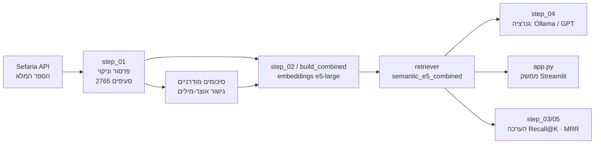

# RAG_hlacha — מערכת RAG לקיצור שולחן ערוך

> **Case-study הנדסי:** בניתי מערכת Retrieval-Augmented Generation מאפס מעל **קיצור שולחן ערוך** המלא (221 סימנים, 2,765 סעיפים), עם מנוע הערכה קפדני — וזיהיתי טכניקת אינדוקס ש**שיפרה שליפת-מקור-מדויקת ב-9 נקודות אחוז** (ref R@1: 0.73 → 0.82).

הקלט: שאלה בעברית טבעית. הפלט: הסעיף/ים ההלכתיים המדויקים שעונים עליה (ואופציונלית — ניסוח תשובה).

---

## תוצאות עיקריות (886 שאלות, כל 221 הסימנים)

| מדד | בסיס (טקסט) | **שיטה מנצחת (סיכום+טקסט)** |
|---|---|---|
| Recall@1 — רמת סימן | 0.84 | **0.90** |
| Recall@10 — רמת סימן | 0.98 | **0.99** |
| Recall@1 — סעיף מדויק | 0.73 | **0.82** |
| MRR — סעיף מדויק | 0.80 | **0.88** |

## ממצאים מרכזיים
1. **גישור אוצר-מילים עובד.** צירוף *סיכום מודרני* (עם מינוח חלופי/הפוך, למשל "מגולה"→"לא מכוסה") לכל סעיף לפני הקידוד שיפר את הדיוק ברמת הסעיף ב-**~9 נקודות** — הגישור על הפער בין שאלה בת-זמננו לטקסט הלכתי ארכאי הוא הלבר המשמעותי.
2. **השליפה חזקה מאוד.** ב-99% מהשאלות הסימן הנכון נמצא ב-top-10; הסעיף המדויק ב-82% כבר במקום הראשון.
3. **ממצא מדיד על גנרציה:** מודל מקומי קטן (DictaLM 7B / Qwen 3B) על CPU **אינו אמין לפסיקה** — נופל ל"מותר" גם כשהסעיף אומר מפורשות "אסור", ולא משתפר עם שום צורת הקשר (נמדד על 100 שאלות). המסקנה: השליפה היא הנכס; פסיקה אמינה דורשת מודל חזק.

## הצינור


## איך זה עובד
- **דאטה:** קיצור שו"ע מ-[Sefaria](https://www.sefaria.org/Kitzur_Shulchan_Arukh); יחידת השליפה = סעיף בודד.
- **שליפה:** `intfloat/multilingual-e5-large`, דמיון קוסינוס מעל NumPy. ה-retriever המוביל מקודד `סיכום מודרני + טקסט`.
- **הערכה:** 886 שאלות מתויגות (מקור סימן:סעיף) המכסות את כל הסימנים; Recall@K ו-MRR ברמת סימן וברמת סעיף.
- **גנרציה (אופציונלי):** שני backends — `ollama` (DictaLM מקומי, אופליין) או `openai` (GPT, מפתח-משלך מ-`.env`). מתויג תמיד כ"אינו פסק".
- **ממשק:** אפליקציית Streamlit (`app.py`), source-first, RTL.

## Scope
- ✅ **הושלם:** איסוף דאטה · ניקוי · אינדוקס ברמת סעיף · סיכומים · embeddings · מנוע הערכה · אבלציות · retriever מנצח · ממשק · שני backends לגנרציה.
- 🔭 **עתיד:** גנרציה אמינה (מודל חזק / GPU / ענן) · reranker · סט שאלות "אמת" שאינן נגזרות מהטקסט.

## התקנה והרצה
```bash
python -m venv .venv
.venv\Scripts\python -m pip install -r requirements.txt

# בניית הדאטה (פעם אחת)
python download_sefaria.py
python step_01_data_loading.py
python step_02_embeddings.py
python build_combined_embeddings.py

# ממשק
.venv\Scripts\streamlit run app.py --server.fileWatcherType none

# שאלה מהירה / הערכה
python step_04_rag_answer.py "האם מותר לטלטל מוקצה בשבת?"
python step_03_evaluate.py --retriever semantic_e5_combined
```
לשימוש ב-GPT: העתק `.env.example` ל-`.env` והכנס `OPENAI_API_KEY`.

## מבנה
```
config.py              הגדרות (מודלים, נתיבים, backend)
download_sefaria.py    איסוף הדאטה מ-Sefaria
step_01..05 / build_*  הצינור (פרסור → embeddings → הערכה → גנרציה)
retrievers/            semantic_e5_large, semantic_e5_combined
app.py                 ממשק Streamlit
gen_presentation.py    מצגת HTML של תוצאות ההערכה
data/                  ספר, seifs, סיכומים, שאלות, embeddings (.npy לא ב-git)
experiments/           תוצאות הערכה
```
> `*.npy`, `.venv/`, ו-`.env` מסוננים מ-git — נבנים מחדש מהסקריפטים.

---
**סטאק:** Python · sentence-transformers (e5-large) · NumPy · Ollama (DictaLM) · OpenAI (אופציונלי) · Streamlit · pandas.
